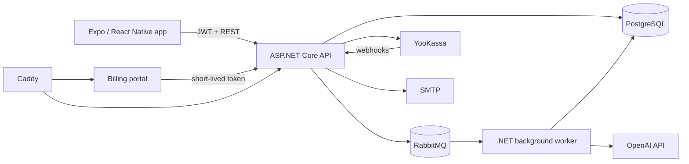

<div align="center">
  
  <h1>Taro</h1>
  <p><strong>A production-oriented mobile tarot platform with asynchronous AI readings, subscriptions, and a complete payment flow.</strong></p>

  
  
  
  
  
  
  
</div>

## About the project

Taro is a full-stack product built around guided tarot readings. The repository contains a cross-platform mobile app, a modular ASP.NET Core backend, a background worker for AI-generated interpretations, and a separate web billing portal.

The project goes beyond a UI prototype: it includes authentication and account recovery, asynchronous job processing, persistent reading history, virtual currency and subscriptions, payment webhooks, email delivery, external sign-in, containerized infrastructure, and production routing through Caddy.

## Product highlights

- Multi-step reading flow with topic selection, spread type, card shuffling, reveal, and saved results.
- Email registration, verification, password recovery, refresh tokens, and external Google/Apple authentication.
- Asynchronous reading generation: the API publishes work to RabbitMQ and a dedicated worker processes it with rate limiting and retry policies.
- PostgreSQL persistence through Entity Framework Core migrations.
- YooKassa checkout, webhook processing, subscription renewal, cancellation, and balance management.
- Mobile-first billing portal with short-lived exchange tokens.
- Docker Compose environment for the API, worker, PostgreSQL, RabbitMQ, billing portal, and Caddy.

## Architecture



## Repository layout

```text
TaroApp/             Expo Router mobile application
Backend/
  Taro.Backend/      API, domain modules, infrastructure, and worker
  SongTranscriber/   Small standalone audio transcription utility
  docker-compose.yml Local and production-like infrastructure
BillingPortal/       Lightweight payment portal
docs/legal/          Launch and compliance notes
```

The backend follows a modular structure:

- `Taro.Api` exposes account, authentication, readings, billing, and webhook endpoints.
- `Taro.Core` contains use cases, DTOs, domain services, and messages.
- `Taro.Infrastructure` implements persistence, authentication, email, OpenAI, and YooKassa integrations.
- `Taro.Worker` consumes reading jobs and runs recurring billing reconciliation.

## Run locally

### Requirements

- Docker Desktop with Docker Compose
- Node.js 20+
- An Android/iOS simulator, physical device, or Expo Go
- .NET 10 SDK only if you want to run backend services outside Docker

### 1. Start the backend stack

```bash
cd Backend
cp .env.example .env
```

Fill in the required values in `Backend/.env`, then run:

```bash
docker compose up --build
```

The compose stack starts PostgreSQL, RabbitMQ, the API, the reading worker, the billing portal, and Caddy.

### 2. Start the mobile app

```bash
cd TaroApp
cp .env.example .env
npm ci
npm start
```

For a device on the same network, replace `localhost` in the mobile `.env` with the LAN address of the machine running the backend.

## Configuration

Real credentials are never committed. Use the two templates:

- `Backend/.env.example` for infrastructure and server-side integrations.
- `TaroApp/.env.example` for public mobile build settings.

At minimum, configure PostgreSQL and RabbitMQ passwords, a JWT signing secret, an OpenAI API key, and the public URLs used by the mobile and billing clients. YooKassa, SMTP, Google, and Apple values are required only for the corresponding integrations.

## Security

If you discover a vulnerability, please report it privately to the repository owner. Do not open a public issue containing credentials, personal data, or an exploit.

This repository contains source code for a portfolio project. Production deployments should use a managed secret store, TLS, restricted database and broker access, and provider-side key rotation.
